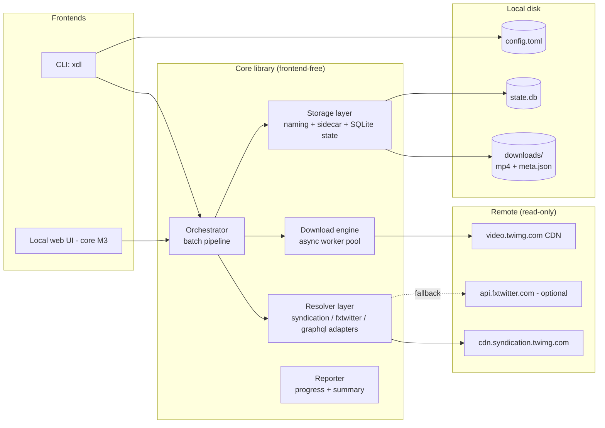
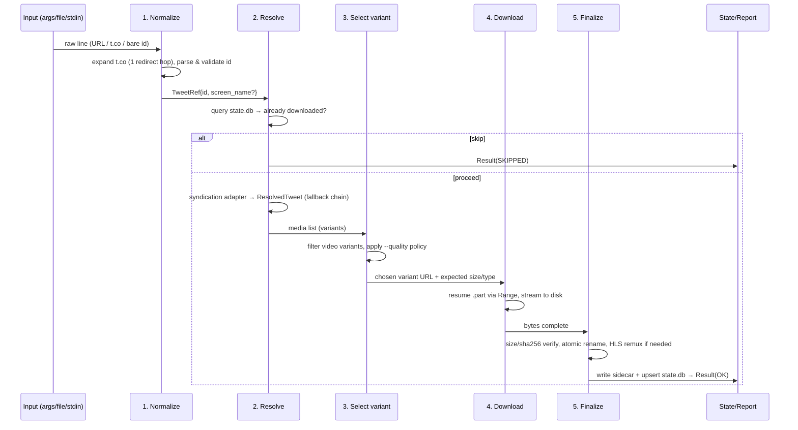

# 02 — Architecture

## Shape of the system

A **single-process, single-user, local application**. No servers, no daemons, no
message queues, no containers. The local web UI (core milestone M3) is the same process
hosting a localhost HTTP server that drives the identical core library.



## The pipeline

Every input item flows through the same stages. Stages are pure-ish functions connected
by the orchestrator; each stage's failure mode is item-local.



### Stage contracts

| Stage | Input | Output | Failure modes |
|---|---|---|---|
| 1. Normalize | raw string | `TweetRef(tweet_id, screen_name?, canonical_url)` | `URL_UNRECOGNIZED`, `TWEET_ID_INVALID` |
| 2. Resolve | `TweetRef` | `ResolvedTweet` (metadata + `list[MediaAsset]`) | `NOT_EMBEDDABLE` (falls through the adapter chain), `NOT_FOUND` (all adapters failed), `NO_VIDEO`, `RATE_LIMITED`, `UPSTREAM_ERROR` |
| 3. Select | `MediaAsset` list | `DownloadJob(url, expected_size, content_type, dest_path)` | `NO_VIDEO` (photo-only), `QUALITY_UNAVAILABLE` |
| 4. Download | `DownloadJob` | completed `.part` file | network/timeout/429/disk errors |
| 5. Finalize | `.part` + `ResolvedTweet` | final file + sidecar + state row | `INTEGRITY_MISMATCH`, `WRITE_ERROR`, `HLS_REQUIRES_FFMPEG` |

Full error semantics: [technical/08-errors-and-rate-limits.md](technical/08-errors-and-rate-limits.md).

## Concurrency model

- **One asyncio event loop, one process.** No threads except where a library forces it
  (ffmpeg subprocess wrapper — actually a subprocess, not a thread).
- **Two semaphores, one queue**:
  - `resolve_sem` (default 4) — metadata lookups are small and fast;
  - `download_sem` (default 3) — video transfers are heavy and are what X rate-limits.
- Items stream through an `asyncio.Queue`; workers pick the next stage that is unblocked.
  In practice the orchestrator runs `resolve` tasks as they come and enqueues download
  jobs, so slow downloads never block resolution of later URLs.
- **Shared `ThrottleState`**: any 429 flips a global `pause_until` timestamp every worker
  checks before each request; `Retry-After` sets it. See
  [technical/08-errors-and-rate-limits.md](technical/08-errors-and-rate-limits.md).
- **Graceful Ctrl+C**: first signal stops intake, lets in-flight chunks finish (bounded
  wait), flushes state, prints summary, exits with code 130. Second signal hard-exits.

Why not multiprocessing: the workload is network-bound; a single event loop with bounded
concurrency saturates a home connection long before the CPU.

## Component descriptions

### Orchestrator (`app.py`)
Owns the batch lifecycle: reads config, builds queues, drives stages, collects
per-item `Result` records, decides skip-vs-proceed, produces the final summary and exit
code. The **only** component the frontends talk to (one entrypoint:
`run_batch(request: BatchRequest) -> BatchReport`).

### Resolver layer (`resolve/`)
- `Resolver` protocol: `async resolve(ref: TweetRef) -> ResolvedTweet`.
- Adapters: `SyndicationResolver` (default), `FxtwitterResolver` (opt-in fallback),
  `GraphQLResolver` (opt-in, cookies, phase 7).
- A `FallbackChain` tries adapters in configured order and maps adapter failures to our
  error taxonomy. Adding a **TikTok resolver later** (this repo's theme) means adding one
  file implementing the protocol — the pipeline never learns source-specific details.
- Details: [technical/02-media-resolution.md](technical/02-media-resolution.md).

### Download engine (`engine/`)
Streaming HTTP GET with Range-resume, `.part` temp files, size verification, optional
sha256, retry/backoff, per-file progress callbacks. Details:
[technical/03-download-engine.md](technical/03-download-engine.md).

### Media post-processing (`media/`)
Variant selection policy (`best`, capped resolutions) and HLS handling (ffmpeg remux,
segment download fallback). Details:
[technical/04-hls-and-ffmpeg.md](technical/04-hls-and-ffmpeg.md).

### Storage layer (`storage/`)
Filename rendering + Windows sanitization, directory layout, sidecar writer, and the
SQLite state store. Details:
[technical/05-storage-naming-dedup.md](technical/05-storage-naming-dedup.md),
[technical/06-metadata-sidecar.md](technical/06-metadata-sidecar.md).

### Reporter (`report/`)
`rich`-based progress bars + summary table for CLI; emits plain events for the web UI to
consume later. The orchestrator emits neutral `ProgressEvent`s; frontends render them.

## Data on disk

```
<downloads_root>/            # default ./downloads relative to cwd; configurable
  x/
    <screen_name>/
      2026-10-01_1750123456789012352.mp4
      2026-10-01_1750123456789012352.meta.json
      2026-10-01_1750123456789012352_v2.mp4     # multi-video posts
%APPDATA%/xdl/               # Windows (platformdirs); ~/.config/xdl on Linux
  config.toml
  state.db                   # SQLite
  logs/xdl.log               # rotating, --verbose increases level
```

## Configuration flow

Precedence (highest wins): **CLI flags > environment (`XDL_*`) > `config.toml` > defaults**.
One `Settings` object (pydantic) is constructed at startup and injected everywhere; no
component reads config implicitly. Full spec:
[technical/07-cli-and-config.md](technical/07-cli-and-config.md).

## Trust and isolation boundaries

- Remote responses are **untrusted input**: parsed with typed models, never `eval`'d, URL
  fields validated against an allowlist of hosts (`*.twimg.com`, `*.x.com`) before a GET.
- Redirects from `t.co` expansion are followed exactly one hop and re-validated by the
  parser (no arbitrary redirect chasing from metadata).
- Cookies (phase 7, opt-in) live only in a user-specified file with a startup warning if
  permissions are looser than owner-only; they are never logged.
